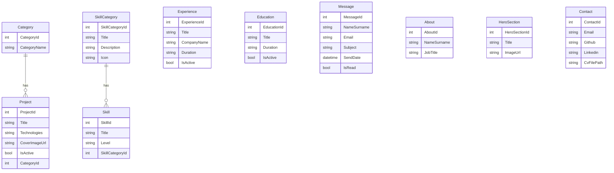

# İpek Sertel · Portfolio

A personal portfolio website with its own admin panel, built with **ASP.NET Core MVC** and **Entity Framework Core (Code First)**. Every section of the public site is managed from the admin panel and stored in SQL Server.

> Developed as the 1st project (Portfolio Case) of the M&Y Yazılım Eğitim Akademi ASP.NET Core MVC program, 12th term.

<!--
Screenshots: add images to a docs/screenshots folder and uncomment the lines below.


-->

## Features

### Public website
- One-page portfolio: hero, about, education, experience, skills, projects, how I work, certificates and contact
- All content comes from the database through **View Components**
- Passive education, experience and project records are hidden
- Education and experience listed by date (newest first)
- Skills grouped by category, each with a level indicator (Advanced / Intermediate / Beginner)
- Project cards with category filter, technology tags, GitHub and live demo links
- Contact form saved to the database, validated in the browser and on the server (AJAX, no page reload)
- **Download CV** button serving the latest uploaded PDF
- Dark "Midnight" theme, responsive layout

### Admin panel (`/Admin`)
- **Dashboard:** project, skill, experience, education and message statistics, latest 5 messages, latest 3 projects, projects per category and quick actions (`DashboardViewModel`)
- **Hero & About:** name, title, intro text, profile image and biography
- **Education & Experience:** CRUD, date ordering, colored Active/Passive status that can be toggled from the list
- **Skills:** skill categories and skills (one-to-many)
- **Projects & Categories:** CRUD, category dropdown, image upload with type/size checks, Active/Passive status
- **Messages:** read/unread status, search by sender or subject, date sorting, unread counter, Bootstrap Modal detail view; the original message is never edited
- **Settings:** contact details, social links and CV upload (PDF only)
- Delete confirmations and result notifications with **SweetAlert2**

## Tech stack

| Layer | Technology |
|---|---|
| Framework | ASP.NET Core MVC (.NET 10) |
| Data | Entity Framework Core, Code First migrations, SQL Server |
| UI | Razor views, View Components, Bootstrap 5, Bootstrap Icons |
| Libraries | SweetAlert2 |

## Techniques used

- **Data Annotations** (`Required`, `StringLength`, `Range`, `EmailAddress`) with `ModelState.IsValid` and form error messages
- **Relationships:** `Category → Project` and `SkillCategory → Skill` (one-to-many, FK + navigation property), `Include`
- **LINQ:** `Where`, `Count`, `OrderByDescending`, `Take`, `GroupBy`, `Any`
- **SelectList / `asp-items`** dropdowns
- **File upload** with `IFormFile`: allowed extensions, size limit, unique GUID file names, stored under `wwwroot/uploads`; PDFs are checked by their file signature (`%PDF`)
- **TempData** for one-time notifications after redirects
- **Areas** for the admin panel, **View Components** for homepage sections, a **ViewModel** for the dashboard

## Database



## Getting started

1. Install the [.NET 10 SDK](https://dotnet.microsoft.com/download) and SQL Server (Express is enough).
2. Clone the repository:
   ```bash
   git clone https://github.com/ipekgozlek/MYAcademy_PortfolioProject.git
   ```
3. Check the connection string in `appsettings.json` (`ConnectionStrings:DefaultConnection`). The default uses a local `SQLEXPRESS` instance and a database named `PortfolioDb`.
4. Create the database from the migrations (Package Manager Console):
   ```
   update-database
   ```
   or with the .NET CLI:
   ```bash
   dotnet ef database update
   ```
5. Run the project. The portfolio opens at `/`, the admin panel at `/Admin`.

## Project structure

```
Areas/Admin/          Admin panel: controllers and views for every module
Context/              PortfolioContext (DbContext)
Entities/             Database entities with validation attributes
Helpers/              DurationHelper (date ordering), FileHelper (uploads)
Models/               DashboardViewModel
ViewComponents/       One component per homepage section
Views/Default/        Public one-page portfolio
wwwroot/css/          admin.css and the Midnight theme files
Migrations/           EF Core Code First migrations
```

## Author

**İpek Sertel** · Computer Engineer
[GitHub](https://github.com/ipekgozlek)
